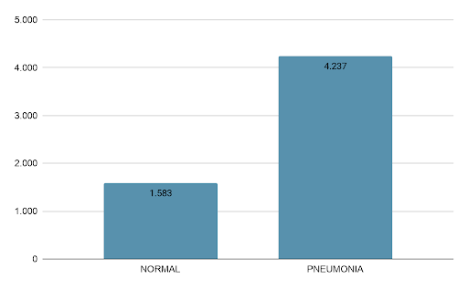
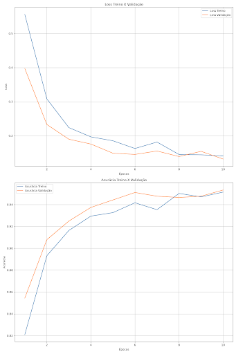
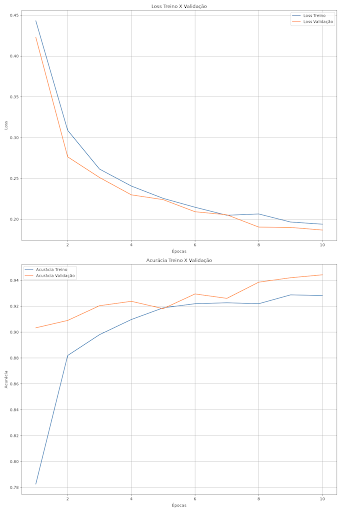
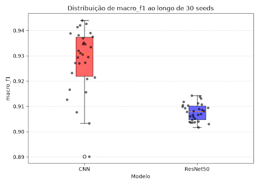
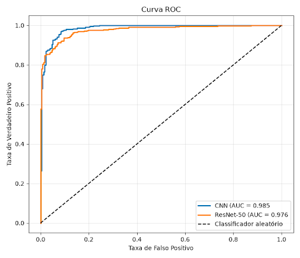

# Comparação entre CNN Treinada do Zero e ResNet-50 com Transfer Learning para Classificação de Pneumonia em Radiografias de Tórax

**Universidade Federal de São Paulo**
**Breno Silveira Signorini Verdi**

---

## Abstract

A pneumonia é uma das principais causas da mortalidade infantil e está diretamente relacionada à ODS 3 (Saúde e Bem-Estar) da Agenda 2030 da ONU. Em um ambiente com poucos recursos, a triagem rápida de radiografias de tórax pode reduzir o tempo de diagnóstico e aliviar a sobrecarga de especialistas. Este trabalho compara duas abordagens de classificação binária (NORMAL vs PNEUMONIA) em radiografia de tórax: uma rede convolucional (CNN) treinada do zero e uma ResNet-50 pré-treinada via transfer learning (com backbone congelado). Utilizamos um dataset de aproximadamente 5900 imagens de radiografia de tórax, realizamos 30 execuções em cada algoritmo do modelo e obtemos o seguinte resultado: a CNN, com acurácia de 94,38% ∓ 0,92%, superou o modelo ResNet-50 pré-treinado, com acurácia de 92,63% ∓ 0,26%, com diferença estatisticamente significativa de p-valor < 0,0001 resultante do teste Mann-Whitney. Os resultados sugerem que, neste cenário com o backbone congelado, a CNN treinada do zero apresentou vantagem comparada ao ResNet-50 com transfer-learning.

---

## I. Introdução

A Organização das Nações Unidas estabeleceu, na Agenda 2030, 17 Objetivos de Desenvolvimento Sustentável (ODS), dentre os quais o ODS 3, Saúde e Bem-Estar, visa garantir acesso a serviços. A pneumonia permanece como uma das principais causas de mortalidade infantil no mundo, sendo responsável por 610 mil mortes de crianças menores de cinco anos em 2023, segundo o Global Burden of Disease [1]. O diagnóstico é, em geral, realizado por radiografias de tórax, a interpretação correta desse exame exige um conhecimento especializado, que acaba sendo escasso em regiões de menor renda. Essa lacuna entre a quantidade de exames realizados e a capacidade de interpretar os resultados adequadamente motiva o desenvolvimento de sistemas automatizados para auxiliar no diagnóstico.

Com isso, esse trabalho propõe a comparação de um modelo treinado do zero com o ResNet-50 com transfer-learning, um modelo pré-treinado, com um processo estatístico rigoroso (30 execuções independentes por algoritmo) e análises de sensibilidade a hiperparâmetros como profundidade arquitetural, taxa de aprendizado e balanceamento de classes.

Esse relatório está organizado da seguinte maneira: a Seção II discute trabalhos relacionados; a Seção III descreve a metodologia, incluindo o conjunto de dados e a configuração experimental; a Seção IV apresenta os resultados e a discussão; e a Seção V traz as conclusões.

---

## II. Trabalhos Relacionados

Kermany et al. [2] propuseram o conjunto de imagens de radiografia de tórax utilizadas nesse trabalho, demonstrando a possibilidade de classificação de doenças pulmonares. Os autores aplicaram uma arquitetura Inception V3 pré-treinada, alcançando acurácia de 92% na classificação das radiografias, estabelecendo a base de dados e a metodologia de referência adotadas por boa parte dos trabalhos seguintes, incluindo este.

Nettur et al. [3] propuseram um modelo leve de ensemble por média ponderada, combinando dois modelos pré-treinados com pesos otimizados, utilizando o mesmo conjunto de dados do Kermany et al. [2] empregado neste trabalho. Os autores aplicaram o fine-tuning parcial, um meio termo entre o backbone totalmente congelado, como realizado nesse trabalho, e o fine-tuning.

Um estudo comparativo de detecção de pneumonia pediátrica [4] avaliou diretamente CNNs treinadas do zero contra arquiteturas pré-treinadas, constatando que o transfer learning com fine-tuning superou substancialmente as CNNs treinadas do zero, além de que os modelos com o backbone totalmente congelado apresentaram um desempenho inferior comparados aos modelos com fine-tuning.

Zhang et al. [5] desenvolveram um conjunto de dados médicos reunindo diversos conjuntos de dados públicos de radiografias, tomografias e ressonância magnética. Os autores utilizaram esse novo conjunto de dados para pré-treinamento de modelos, e notou-se em comparação com o ImageNet, que os modelos pré-treinados com esse novo conjunto superaram os modelos pré-treinados com o ImageNet, evidenciando que o domain gap entre os datasets é um fator relevante para o desempenho do modelo.

Por fim, uma comparação entre ResNet-50, VGG-19 e uma CNN treinada do zero [6] para classificação de imagens médicas mostrou que o modelo treinado do zero, embora não tenha superado os pré-treinados, se aproximou da performance deles. Um possível motivo para esse resultado é o fato do fine-tuning realizado nos modelos pré-treinados.

---

## III. Metodologia

### A. Conjunto de Dados

Neste trabalho, utilizamos o dataset Chest X-Ray Images (Pneumonia), disponibilizado no Kaggle por Mooney [7] e originalmente proposto por Kermany et al. [2].

O dataset possui 5.863 radiografias de diferentes tamanhos no formato JPEG, onde 4.237 são da classe PNEUMONIA e 1.583 são da classe NORMAL, ou seja, temos um dataset desbalanceado (2,67:1) para esse projeto.

Identificou-se que a divisão original do conjunto de validação (16 imagens) era insuficiente para estimativas estatisticamente confiáveis, conforme evidenciado pela alta variância nas métricas obtidas em testes preliminares. Por esse motivo, optou-se por unificar todas as imagens e realizar uma divisão própria (70%/15%/15% para treino/validação/teste), preservando a proporção de classes em cada subconjunto.

O pré-processamento incluiu redimensionamento para 224x224 pixels, normalização segundo as estatísticas do ImageNet (μ=[0,485, 0,456, 0,406], σ=[0,229, 0,224, 0,225]) e, para o conjunto de treino, aumento de dados (data augmentation) via espelhamento horizontal e rotação aleatória de até 10°.

*Fig. 1. Distribuição de classes no conjunto de dados (NORMAL: 1.583; PNEUMONIA: 4.237).*

### B. Configuração do Algoritmo e do Ambiente Computacional

No processo de treinamento, utilizamos um desktop com processador Ryzen 5 5600, GPU RTX 5060 Ti 16GB VRAM e 16GB de RAM com o Windows como SO.

Utilizamos o Python 3.11.9, PyTorch 2.11.0+cu128 e Torchvision 0.26.0+cu128 para executar os modelos.

**Algoritmo 1 – CNN do zero:** arquitetura com cinco blocos convolucionais (32 → 64 → 128 → 256 → 512 canais), cada um seguido de normalização em lote (BatchNorm2d), ativação ReLU e max-pooling 2x2. A saída é reduzida via global average pooling adaptativo (AdaptiveAvgPool2d) antes de quatro camadas totalmente conectadas (512 → 256 → 128 → 64 → 2), com dropout (p=0,3) antes da camada final.

**Algoritmo 2 – ResNet-50 com Transfer Learning:** backbone pré-treinado no ImageNet, com todos os parâmetros convolucionais congelados; a camada totalmente conectada final foi substituída por uma camada com dropout (p=0,2) seguida de uma camada linear para duas classes.

**Tabela I – Hiperparâmetros finais de cada algoritmo**

| Parâmetro     | CNN     | ResNet-50 |
|---------------|---------|-----------|
| Learning rate | 0,00005 | 0,0005    |
| Batch Size    | 64      | 64        |
| Épocas        | 10      | 10        |
| Otimizador    | Adam    | Adam      |
| class_weight  | Não     | Não       |

### C. Critérios de Análise

Cada algoritmo foi executado 30 vezes com sementes (seeds) diferentes (0 a 29) para controle de aleatoriedade na inicialização dos pesos e na ordem de amostragem dos lotes de treino. Em cada execução, registrou-se: acurácia, loss e F1-score (por classe e macro-médio) no conjunto de teste, bem como o tempo total de treinamento.

Para cada métrica, testou-se a normalidade das distribuições via teste de Shapiro-Wilk (α=0,05) e foi observado que nenhuma seguiu a distribuição normal. Logo, aplicou-se o teste não paramétrico de Mann-Whitney U.

---

## IV. Análise Experimental

### A. Curvas de Treinamento

Durante os testes iniciais da CNN do zero, foi observada uma instabilidade nas curvas de acurácia da validação, então decidiu-se reduzir o learning rate, de 0,001, gradualmente durante diversos testes até que atingiu-se o valor de 0,00005, onde não se observou mais instabilidade durante as épocas iniciais.

Nos treinamentos iniciais da ResNet-50, também observou-se instabilidade com o learning rate inicial de 0,001, assim reduzimos para 0,0005 e eliminou-se a instabilidade inicial do treinamento.

Nota-se que, em ambas, obteve-se um crescimento suave das curvas de acurácia, além da proximidade entre a acurácia de treino e validação, e uma redução suave das curvas de loss, onde ambas as curvas de loss do treino e validação se mantêm próximas.

*Fig. 2. Curvas de treinamento da CNN (seed=7).*

*Fig. 3. Curvas de treinamento da ResNet-50 (seed=7).*

### B. Resultados Agregados (30 Execuções)

**Tabela II – Estatísticas descritivas (média ∓ desvio-padrão / mediana)**

| Métrica         | CNN                      | ResNet-50                |
|-----------------|--------------------------|--------------------------|
| Acurácia Teste  | 94,38% ∓ 0,92% / 94,60%  | 92,63% ∓ 0,26% / 92,61%  |
| F1 Macro        | 0,928 ∓ 0,012 / 0,930    | 0,907 ∓ 0,003 / 0,908    |
| F1 Normal       | 0,894 ∓ 0,019 / 0,898    | 0,866 ∓ 0,005 / 0,866    |
| F1 PNEUMONIA    | 0,961 ∓ 0,006 / 0,963    | 0,949 ∓ 0,001 / 0,949    |

*Fig. 4. Distribuição do F1-macro ao longo de 30 execuções.*

Ao realizar o teste de hipótese Mann-Whitney na métrica F1-macro, observou-se um p-valor < 0,0001, que é extremamente significativo, evidenciando que existe uma diferença real entre os dois algoritmos utilizados.

### C. Curva ROC e AUC

Em ambos os modelos obteve-se um excelente AUC, evidenciando que ambos apresentam grande capacidade de discriminação entre as classes. Nota-se uma leve vantagem para a CNN treinada do zero (AUC=0,985) em relação ao ResNet-50 (AUC=0,976).

*Fig. 5. Curvas ROC comparativas.*

### D. Análise de Sensibilidade de Hiperparâmetros

**Profundidade Arquitetural (CNN):** Durante a montagem da arquitetura da CNN, foi testado com 3, 4, e por fim 5 camadas. Notou-se, durante o teste, uma notável melhora no desempenho do modelo e, principalmente, na precisão dele, evidenciando que, com mais camadas, foi capaz de extrair as características com mais detalhes.

**Taxa de aprendizado:** Durante o processo de regular os modelos, testou-se diversos valores para o learning rate e foi observado que um learning rate menor para a CNN (lr=0,00005) implicou na estabilização das curvas de acurácia de validação. No entanto, ao aplicar esse mesmo learning rate na ResNet-50, notou-se a piora da estabilidade das curvas. Assim, tivemos que encontrar um learning rate ideal para ResNet-50 no intuito de estabilizar as curvas.

**Balanceamento de classes (class_weight):** Durante o treinamento inicial do modelo ResNet-50, testamos tanto o conjunto de dados balanceado quanto desbalanceado. Notou-se que, com o conjunto desbalanceado, obteve-se uma precisão maior do que com o conjunto balanceado. Portanto, adotamos o conjunto desbalanceado para ambos os modelos, mantendo um padrão nos testes.

**Tabela III – Sensibilidade a hiperparâmetros (resumo)**

| Configuração          | Acurácia | F1 Macro |
|-----------------------|----------|----------|
| CNN 3 camadas         | 91,0%    | 0,89     |
| CNN 4 camadas         | 93,1%    | 0,91     |
| CNN 5 camadas         | 95,1%    | 0,94     |
| ResNet-50 lr=0,0005   | 92,72%   | 0,92     |
| ResNet-50 lr=0,0001   | 90,1%    | 0,88     |

---

## V. Conclusões

Considerando a lacuna entre a quantidade de radiografias realizadas e a capacidade de interpretação dos resultados, realizamos o treinamento de uma CNN do zero e comparamos com o modelo ResNet-50 utilizando transfer learning. Assim, obtivemos alguns resultados interessantes, como a maior acurácia e precisão do modelo treinado do zero.

Como limitação, destaca-se que o backbone na ResNet-50 permaneceu integralmente congelado durante todos os experimentos, o que pode ter restringido sua capacidade de adaptação ao domínio de imagens radiográficas, um domínio visualmente distante do ImageNet, conforme discutido na literatura [5].

Como trabalhos futuros, sugere-se: (i) avaliar o fine-tuning parcial do backbone da ResNet-50, descongelando progressivamente suas últimas camadas; (ii) incorporar um agendador de taxa de aprendizado (learning rate scheduler) para mitigar possíveis instabilidades; e (iii) ampliar o conjunto de dados com imagens de outras fontes para avaliar a generalização dos modelos.

---

## Referências

[1] FORUM OF INTERNATIONAL RESPIRATORY SOCIETIES. Pneumonia remains leading cause of child mortality. Global Initiative for Chronic Obstructive Lung Disease (GOLD), 12 nov. 2025.

[2] D. Kermany et al., "Identifying Medical Diagnoses and Treatable Diseases by Image-Based Deep Learning," Cell, 2018.

[3] NETTUR, Suresh Babu; KARPURAPU, Shanthi; NETTUR, Unnati; GAJJA, Likhit Sagar; MYNENI, Sravanthy; DUSI, Akhil; POSHAM, Lalithya. Lightweight weighted average ensemble model for pneumonia detection in chest X-ray images. Computing and Artificial Intelligence, v. 3, n. 2, p. 3104, 2025.

[4] CHOUDHURY, Agniv Roy. Pediatric pneumonia detection from chest X-rays: a comparative study of transfer learning and custom CNNs. arXiv, 2025.

[5] ZHANG, Rongguo; PEI, Chenhao; SHI, Ji; WANG, Shaokang. Construction and validation of a general medical image dataset for pretraining. Journal of Imaging Informatics in Medicine, 2024. DOI: 10.1007/s10278-024-01226-3.

[6] IKECHUKWU, A. Victor; MURALI, S.; DEEPU, R.; SHIVAMURTHY, R. C. ResNet-50 vs VGG-19 vs training from scratch: a comparative analysis of the segmentation and classification of Pneumonia from chest X-ray images. Global Transitions Proceedings, v. 2, p. 375-381, 2021.

[7] MOONEY, Paul Timothy. Chest X-Ray Images (Pneumonia). Kaggle, 2018.
